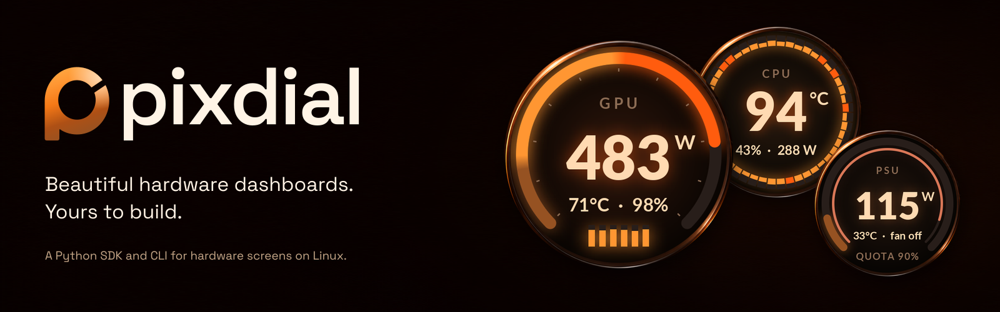
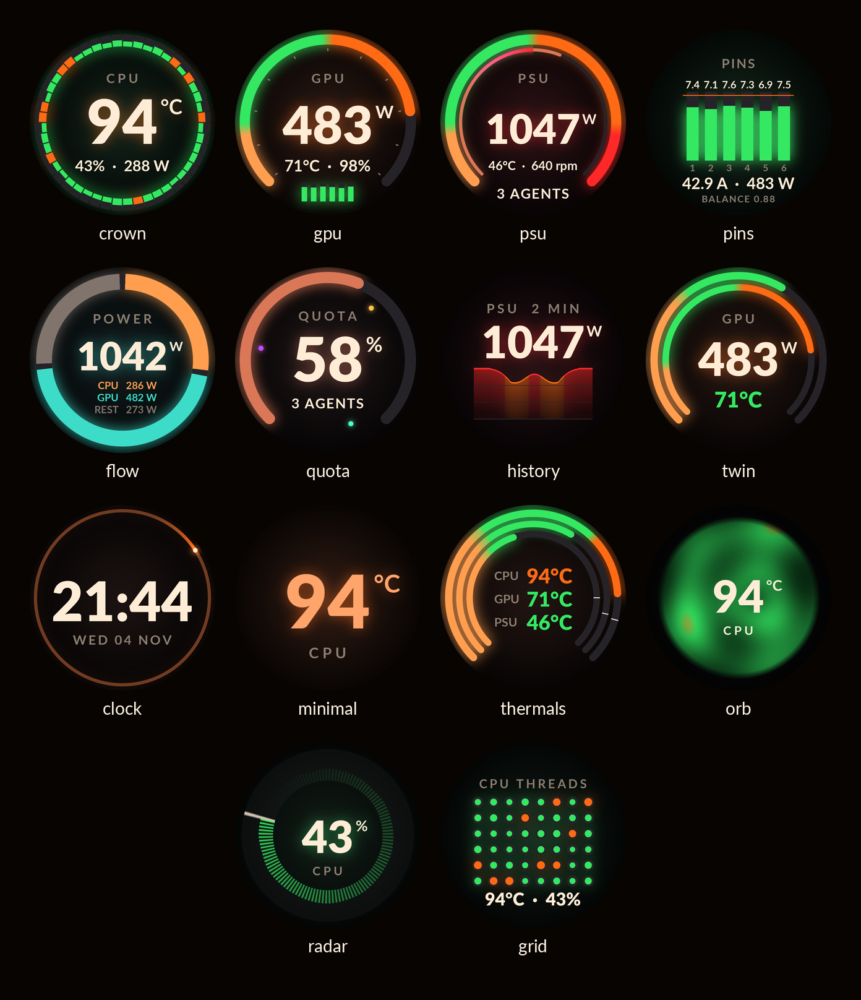
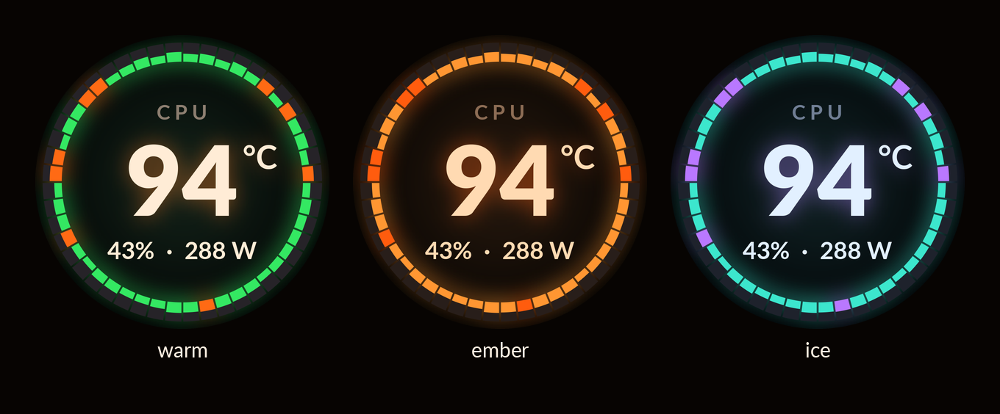
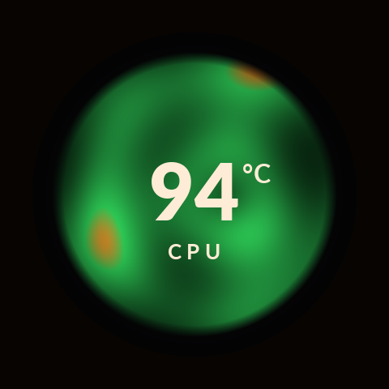

<p align="center">
  
</p>

<p align="center">
  <a href="https://github.com/YordiLorenzo/pixdial/actions/workflows/ci.yml"></a>
  <a href="https://pypi.org/project/pixdial/"></a>
  <a href="pyproject.toml"></a>
  <a href="LICENSE"></a>
</p>

**pixdial puts live hardware readings on Lian Li UNI FAN SL Wireless LCD (SL V3) fans on Linux. Build your own
designs in Python.**

Pick from 14 designs for CPU load, temperatures, power, a clock and more, and match them to your build with three
themes. pixdial draws each frame on the host and sends it over USB. It draws the screens only: fan speed and RGB
stay with lian-li-linux, or whatever controls them now.

[Website](https://yordilorenzo.github.io/pixdial/) · [Quick start](#quick-start) · [Supported hardware](#supported-hardware) · [Build a design](#build-a-design)



## Quick start

You need Linux, Python 3.12 or newer, [uv](https://docs.astral.sh/uv/getting-started/installation/), and a
[supported panel](#supported-hardware). For a preview without hardware, install pixdial and run
`pixdial render crown --state busy --out preview`.

1. **Install.**

   ```sh
   uv tool install pixdial
   ```

   `pipx install pixdial` works too. If your shell cannot find `pixdial`, run `uv tool update-shell` and open a
   new terminal.

2. **Set up the panels.**

   ```sh
   pixdial setup
   ```

   Setup finds the attached panels and gives your user access to them: it prints the udev commands, then runs
   them through sudo, which asks for your password once. It writes `~/.config/pixdial/config.toml` with a design
   for each panel and runs the `pixdial doctor` checks. `pixdial setup --dry-run` shows the same steps and
   changes nothing. If a display is upside down, add `turn = 180` to its `[[panels]]` table in the config.

3. **Start the service.**

   ```sh
   pixdial service install
   ```

   The panels show their designs now and after every login. To try pixdial in a terminal first, run
   `pixdial run`; Ctrl-C stops it and turns the panels dark.

On a machine where pixdial starts with nobody logged in (linger, or no login at its seat), setup installs a group
rule instead and adds your user to the `pixdial` group. Log out and back in (with linger, reboot) before step 3.

In another terminal, `pixdial show crown:ember` changes the configured panel's design and theme.
`pixdial show rotate` cycles through the designs.

<details>
<summary>Set up by hand</summary>

1. Install the [bundled udev rule](src/pixdial/data/60-pixdial.rules). It gives the user logged in at the machine
   access to the panels. For a machine nobody logs in to, use the
   [group rule](docs/config.md#usb-permissions) instead.

   ```sh
   sudo tee /etc/udev/rules.d/60-pixdial.rules >/dev/null <<'RULE'
   SUBSYSTEM=="usb", ATTRS{idVendor}=="1cbe", ATTRS{idProduct}=="0005", TAG+="uaccess"
   SUBSYSTEM=="usb", ATTRS{idVendor}=="1cbe", ATTRS{idProduct}=="0006", TAG+="uaccess"
   RULE
   sudo udevadm control --reload-rules
   sudo udevadm trigger --subsystem-match=usb --action=add
   pixdial devices
   ```

2. Write the config, with the serial that `pixdial devices` printed in place of `YOUR_PANEL_SERIAL`. Add one
   `[[panels]]` table and one layout entry for each extra panel.

   ```sh
   mkdir -p ~/.config/pixdial
   cat > ~/.config/pixdial/config.toml <<'TOML'
   layout = ["crown"]

   [[panels]]
   name = "cpu"
   serial = "YOUR_PANEL_SERIAL"
   TOML
   ```

3. Check the readings, then start pixdial.

   ```sh
   pixdial doctor
   pixdial service install
   ```

</details>

## What it does

### Designs that fit the screen

- **Fourteen round layouts.** Gauges, thread grids, power history, temperature rings and a clock, with type fitted
  to the panel.
- **Three themes.** `warm`, `ember` and `ice`, selected per panel. Changing designs fades between them;
  animated designs run at up to 30 frames per second.
- **Readable when a sensor goes away.** Missing or stale measurements show a dash instead of a frozen number.



<p align="center"></p>

### Readings with useful scales

- **Limits from the hardware.** Gauges use reported sensor limits, GPU power limits and slowdown temperatures
  when available. [Config overrides and fallback ranges](docs/config.md#readings-and-ranges) cover the rest.
- **Local sensors and your own data.** CPU load and power, NVIDIA GPU readings, AMD GPU readings (experimental)
  and Linux hardware sensors are built in. Add PSU readings, connector currents or agent quota through configured
  sensors, a command that prints JSON, or a Python source.

### Make it yours

- **Python plugins.** Add a design, source or device without changing pixdial. The runtime handles sampling,
  layout changes and frame delivery.
- **Preview before connecting.** Render PNGs and an HTML gallery from demo readings, or use the PNG device to
  try a live layout without a physical panel.

## Supported hardware

| Panel | USB ID | Display | Status |
| --- | --- | --- | --- |
| Lian Li UNI FAN SL Wireless LCD (SL V3) | `1cbe:0005` | Round, 400 × 400 | Tested |
| Lian Li UNI FAN TL Wireless LCD (TL V2) | `1cbe:0006` | Round, 400 × 400 | Experimental |

Both run on Linux. Each LCD needs its own USB cable to a USB 2 header: despite the fan's name, its LCD receives
frames over USB, not over the wireless dongle. `lsusb | grep 1cbe` lists the panels attached.

The TL Wireless LCD speaks the same protocol as the SL V3, but no TL panel has been tested with pixdial yet. If you
have one, a [device test report](https://github.com/YordiLorenzo/pixdial/issues/new?template=device-test.yml)
helps. Other Lian Li LCDs and AIO screens need their own tested [device plugins](docs/plugins.md#devices).
pixdial does not control fan speed or RGB lighting.

## CLI

| Command | Use |
| --- | --- |
| `pixdial setup` | Find the panels, give your user access, write the config and run the checks; `--dry-run` changes nothing. |
| `pixdial service install` | Start `run` now and at every login, as a systemd user service; `service status` and `service remove` too. |
| `pixdial run` | Run the configured panels until Ctrl-C or SIGTERM; `--debug --log-file PATH` writes a detailed log. |
| `pixdial show crown:ember` | Set one design per configured panel; `show` alone prints the selection, `show rotate` cycles designs. |
| `pixdial list` | List designs, themes, sources and devices, including installed plugins. |
| `pixdial devices` | Find attached panels and check access. |
| `pixdial render crown --out preview` | Render a PNG from demo readings; `render --gallery preview` builds the full gallery. |
| `pixdial doctor` | Check config, fonts, plugins, panel permissions, layout and source readings; `--share` prints them for an issue. |

Put `--config PATH` before the command to use another TOML file. Render states are `idle`, `busy`, `waiting`,
`full` and `missing`; `--scale 2` produces an 800 × 800 image. Exit codes are 0 for success, 1 for a failed check
or no devices found, and 2 for a usage or config error.

[Configuration](docs/config.md) covers multiple panels, sources, rotation and running at login.

## Build a design

A design turns a snapshot into a picture. Save this as `demo.py` in a [source checkout](#development), then
run `uv run python demo.py` to write `demo.png`:

```python
from pixdial.designs import LOAD, THEMES, Design
from pixdial.readings import Reading, Snapshot


class Load(Design):
    name = "load"
    shows = "CPU load on a gauge"

    def update(self, readings, now, dt):
        self.value = readings.number("cpu_load")
        return self.value, None

    def still(self):
        frame = self.frame(self.colour(LOAD, self.value))
        self.gauge(frame, self.value, LOAD)
        self.label(frame, "CPU LOAD")
        frame.number(246, self.value, "%")
        return frame.finish()


design = Load(THEMES["warm"])
design.update(Snapshot({"cpu_load": Reading(42, "%")}, wall=0), now=0, dt=0)
design.render(now=0).save("demo.png")
```

Register the class through the `pixdial.designs` entry-point group to use it by name in the CLI.
[The plugin guide](docs/plugins.md) covers registration, animation, history and all three extension points.
[examples/plugin](examples/plugin/) is a complete installable plugin with a design, source and device.

## What pixdial touches

The SL V3 driver talks to the panel over USB. It sends revision and version queries, frame-rate setup, JPEG
frames and brightness. It never sends firmware-write, reboot, panel-rotation, startup-image or storage commands.
The `turn` option rotates the image on the host. Stopping normally sets the panel's brightness to zero.

Built-in sensor readers read local files or NVML. pixdial has no telemetry or network service. A command source
or installed plugin can use the network and has your user's permissions; only configure code you trust.
`doctor` reads sources too, so it can execute configured commands.

`show` saves the layout in `$XDG_STATE_HOME/pixdial/layout` (default `~/.local/state/pixdial/layout`).
`render` writes to its output directory; file devices write to the paths you configure.
See [Architecture](docs/architecture.md) and [Security](SECURITY.md) for the boundaries.

## Credits and alternatives

[sgtaziz/lian-li-linux](https://github.com/sgtaziz/lian-li-linux) is a Linux replacement for L-Connect 3, under
the MIT licence. It controls fan speed, pumps and RGB lighting on many Lian Li devices, and drives their LCDs with
images, GIFs, video, sensor presets, templates and a template editor. pixdial's SL V3 driver follows its daemon's
`slv3_lcd.rs` and `crypto.rs` at v1.2.6 (Copyright (c) 2026 sgtaziz, MIT). Choose lian-li-linux for the fans, the
RGB and layouts you build in an editor. pixdial draws the LCDs only, with its own designs, hardware-derived ranges
and Python plugins, and runs beside it.

Rendering uses [Pillow](https://python-pillow.org/) and [NumPy](https://numpy.org/), with
[cryptography](https://cryptography.io/) for the panel's command headers. The bundled
[Lato fonts](https://www.latofonts.com/) by Łukasz Dziedzic retain their
[SIL Open Font License](src/pixdial/fonts/LICENSE-Lato.txt).

pixdial is not affiliated with Lian Li or the hardware manufacturers named here.

## Troubleshooting and undo

`pixdial doctor` checks the config, the panels and each source, with a hint under each problem.

- **No access to a panel.** `doctor` says ``no read and write access to ...: `pixdial setup` gives it``. Run
  `pixdial setup`.
- **Another program holds a panel.** `doctor` says `claimed by <program> (pid <n>), so pixdial can't open it`.
  If that is lian-li-linux, take the LCD out of its LCD list, as in
  [the FAQ](#can-i-run-it-alongside-lian-li-linux).
- **A panel stays black, or `pixdial devices` finds none.** Each LCD needs its own USB cable to a USB 2 header
  on the motherboard: the wireless dongle does not carry frames. `lsusb | grep 1cbe` lists the panels attached.
- **GPU readings are missing.** NVIDIA readings need the NVIDIA driver. AMD readings come from the experimental
  `amdgpu` source: if `doctor` shows nothing for `source amdgpu` on a Radeon card, please send a
  [Radeon report](https://github.com/YordiLorenzo/pixdial/issues/new?template=radeon.yml). The default rotation
  leaves out designs whose readings no source gives, and `doctor` lists them.

**To report a problem,** open a [bug report](https://github.com/YordiLorenzo/pixdial/issues/new?template=bug.yml)
with the output of `pixdial doctor --share`. It takes out the panel serials, the hostname and your home folder.
For a log, stop the service first (only one program can hold a panel), run pixdial until the problem shows, then
press Ctrl-C and start the service again:

```sh
systemctl --user stop pixdial
pixdial run --debug --log-file pixdial.log
systemctl --user start pixdial
```

The log holds file paths, so read it before you share it.

**To undo the setup,** remove the service, the udev rule and pixdial's config and state folders:

```sh
pixdial service remove
sudo rm /etc/udev/rules.d/60-pixdial.rules
sudo udevadm control --reload-rules
rm -rf ~/.config/pixdial ~/.local/state/pixdial
uv tool uninstall pixdial
```

If setup added your user to the `pixdial` group, `sudo gpasswd -d "$USER" pixdial` takes it out. If you took
LCDs out of lian-li-linux's config, put them back and restart its daemon.

## FAQ

### Can I try it without a panel?

Yes. `pixdial render crown --out preview` needs no hardware. For a running layout, use the
[PNG device example](docs/config.md#try-a-live-layout-without-hardware). Rendering also works on macOS;
physical panel support is Linux-only.

### Why are some values missing?

The default sources read CPU load, RAPL package power, AMD GPU readings (experimental), NVIDIA GPU readings and
CPU temperature via hwmon. Availability depends on your hardware, drivers and file permissions. The default
rotation leaves out designs whose readings no source gives. PSU readings, connector currents and agent
quota need [additional sources](docs/config.md#sources). `pixdial doctor` shows what each source can read.

### Can I run it alongside lian-li-linux?

Yes. lian-li-linux keeps fan speed and RGB, and pixdial draws the LCDs. Each LCD takes one program at a time, so
take the LCDs pixdial drives out of lian-li-linux's LCD list: delete their entries under `lcds` in its
`config.json` (in `~/.config/lianli/` for its user service, `/var/lib/lianli/` for its system service). Then
restart its daemon:

```sh
systemctl --user restart lianli-daemon       # the user service
sudo systemctl restart lianli-daemon-system  # the system service
```

While another program still holds a panel, `pixdial doctor` names it.

### Does it need root?

No. pixdial runs as your user. The panel needs read and write access to its USB device node: `pixdial setup`
installs a udev rule for that through sudo, after it prints the commands. That is the only step that runs as
root. RAPL counters can need separate read permission.

## Development

```sh
git clone https://github.com/YordiLorenzo/pixdial.git
cd pixdial
uv sync --locked
uv run ruff check
uv run mypy
uv run pytest -q
```

[CONTRIBUTING.md](CONTRIBUTING.md) covers golden images, rebuilding the graphics and adding designs, sources
or devices. [Architecture](docs/architecture.md) maps the code; [CHANGELOG.md](CHANGELOG.md) tracks changes.
Report vulnerabilities privately through [SECURITY.md](SECURITY.md).

## Licence

pixdial is free software under the [GNU General Public License, version 3 or later](LICENSE)
(`GPL-3.0-or-later`). You may use, modify and redistribute it, including commercially, under those terms.
Bundled fonts keep their own licence as credited above.
